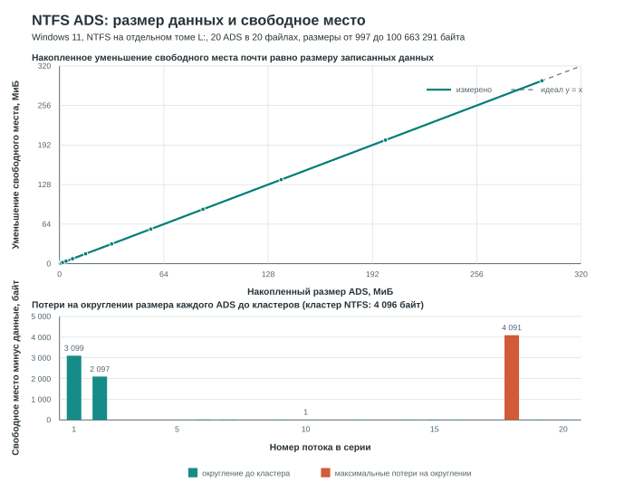

# Лабораторная работа №1

## Дополнительные потоки данных NTFS

### Среда и методика

Эксперимент выполнен 28.09.2026 в гостевой Windows 11 под Parallels Desktop. Для измерений использован отдельный динамический VHDX с максимальным размером 512 МиБ, отформатированный в NTFS и подключенный как `L:`. Размер тома, сообщаемый Windows, составил 535 752 704 байта; `fsutil fsinfo ntfsinfo L:` подтвердил размер кластера 4 096 байт. Каталог новой серии: `L:\lab1_ads_files_20260928`.

Подготовлено 20 отдельных файлов-контейнеров. В каждом создан поток `payload.bin`; размеры потоков от 997 до 100 663 291 байта, все значения нечётные и поэтому не кратны 1 КиБ. Проверка через `Get-Item -Stream payload.bin` подтвердила, что логическая длина каждого потока точно равна запрошенному размеру. Свободное место измерялось через `System.IO.DriveInfo.AvailableFreeSpace`; исходное значение снято после создания контейнерных файлов и до создания ADS.

### 1.0. Размер файла до и после создания ADS

Основной поток `test.txt` имел размер 89 байт до создания дополнительного потока и остался 89 байт после создания `aaa.txt`. При этом `dir /r` показал отдельный поток `test.txt:aaa.txt` размером 304 байта. Таким образом, размер, отображаемый для самого файла, не включает размер ADS.

Дополнительная проверка создала поток `test.txt:echo_verify.txt` размером 18 байт. Размер основного потока при этом также не изменился.

### 1.1–1.2. Свободное место и размер записанных данных

Перед серией на томе было 423 608 320 свободных байтов. Ниже показаны размер каждого ADS, накопленный размер данных, измеренный расход места на данном шаге и оставшееся свободное место.

| Файл | Данные ADS, байт | Накоплено, байт | Расход на шаге, байт | Свободно, байт |
|---|---:|---:|---:|---:|
| baseline | 0 | 0 | 0 | 423 608 320 |
| sample01.bin | 997 | 997 | 4 096 | 423 604 224 |
| sample02.bin | 1 999 | 2 996 | 4 096 | 423 600 128 |
| sample03.bin | 4 093 | 7 089 | 4 096 | 423 596 032 |
| sample04.bin | 8 191 | 15 280 | 8 192 | 423 587 840 |
| sample05.bin | 16 381 | 31 661 | 16 384 | 423 571 456 |
| sample06.bin | 32 749 | 64 410 | 32 768 | 423 538 688 |
| sample07.bin | 65 521 | 129 931 | 65 536 | 423 473 152 |
| sample08.bin | 131 071 | 261 002 | 131 072 | 423 342 080 |
| sample09.bin | 262 139 | 523 141 | 262 144 | 423 079 936 |
| sample10.bin | 524 287 | 1 047 428 | 524 288 | 422 555 648 |
| sample11.bin | 1 048 573 | 2 096 001 | 1 048 576 | 421 507 072 |
| sample12.bin | 2 097 143 | 4 193 144 | 2 097 152 | 419 409 920 |
| sample13.bin | 4 194 301 | 8 387 445 | 4 194 304 | 415 215 616 |
| sample14.bin | 8 388 593 | 16 776 038 | 8 388 608 | 406 827 008 |
| sample15.bin | 16 777 199 | 33 553 237 | 16 777 216 | 390 049 792 |
| sample16.bin | 25 165 813 | 58 719 050 | 25 165 824 | 364 883 968 |
| sample17.bin | 33 554 431 | 92 273 481 | 33 554 432 | 331 329 536 |
| sample18.bin | 50 331 653 | 142 605 134 | 50 335 744 | 280 993 792 |
| sample19.bin | 67 108 859 | 209 713 993 | 67 108 864 | 213 884 928 |
| sample20.bin | 100 663 291 | 310 377 284 | 100 663 296 | 113 221 632 |

Суммарно в потоки записано 310 377 284 байта; свободное место уменьшилось на 310 386 688 байт. Разница 9 404 байта совпадает с суммой округления всех 20 потоков до кластеров по 4 096 байт. Для каждого отдельного потока ожидаемое занятое место рассчитывается как $\lceil S/4096\rceil\times4096$, где $S$ — логический размер потока. Например, поток размером 997 байт занимает один кластер (4 096 байт), а 8 191 байт — два кластера (8 192 байта).

Итак, длина данных в ADS остаётся точной до байта, но свободное место на томе меняется квантами размещения файловой системы. У маленьких потоков доля потерь велика, у больших — мала. Первый график показывает почти линейную зависимость суммарного расхода от размера данных; второй визуализирует округление каждого из 20 потоков. Все отдельные замеры укладываются в округление до кластера; заметное превышение расхода над полезными данными не свидетельствует о скрытом содержимом.

### 2.0. Копирование содержимого потока

Команда `more < test.txt:aaa.txt > testdir_verify.txt` завершилась с кодом 0. Созданный обычный файл `testdir_verify.txt` имеет размер 304 байта, совпадающий с размером исходного потока.

### 3.0. Проверка команд cmd.exe

- `more < test.txt:aaa.txt` завершилась успешно и вывела содержимое потока.
- `echo created_by_echo > test.txt:echo_verify.txt` успешно создала ADS; `more` прочитала строку `created_by_echo`.
- `type test.txt:aaa.txt` завершилась с кодом 1 и сообщением об ошибочном имени файла/каталога.
- `type < test.txt:aaa.txt` завершилась с кодом 1 с сообщением о неверном синтаксисе `type`.
- Для чтения и копирования потока в этом эксперименте использовалась форма перенаправления stdin команды `more`.

### 4.0. Проверка приложений

Проверено чтение и копирование потока средствами `cmd.exe`. Открытие потока в Notepad не проверялось: команды в гостевой Windows выполнялись из неинтерактивной системной сессии, поэтому запуск редактора там не подтвердил бы отображение окна пользователю. Результат для Notepad не предполагается.

### Дополнительные замечания

Бинарные данные можно хранить в ADS, открывая поток по имени `имя_файла:имя_потока` через Win32 `CreateFile` и передавая байты через `ReadFile`/`WriteFile`. Для извлечения в исполняемый файл нужно копировать байты без текстового преобразования; `more` для этого не подходит. NTFS-потоки скрыты от обычного `dir`, но Windows может перечислить их с помощью `dir /r`.

Раздельные ACL для основного потока и ADS в этой работе не проверялись. Для окончательного вывода о правах нужен отдельный опыт с разными учетными записями и проверкой чтения/записи основного файла и его потока.

### Артефакты

- Виртуальный диск в гостевой Windows: `C:\Lab1_ADS\lab1_ntfs.vhdx`.
- Сценарий автоматизации: [run_lab1_ads.ps1](run_lab1_ads.ps1).
- Исходные значения всех точек: [ads_measurements.csv](ads_measurements.csv).
- Графики: [ads_space_chart.svg](ads_space_chart.svg).
- Потоки находятся в `L:\lab1_ads_files_20260928\sample01.bin`–`sample20.bin`; команды `dir /r` показывают ADS `payload.bin` и их размеры.